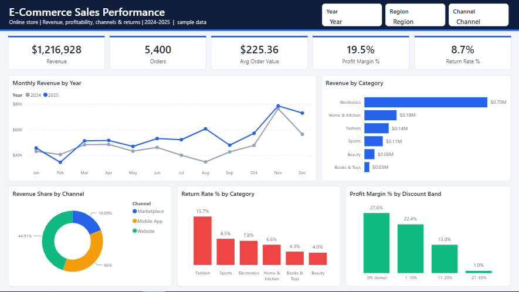
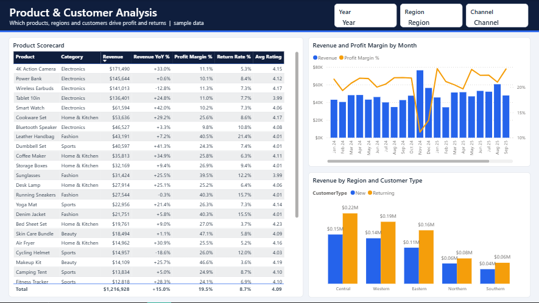

# E-Commerce Sales Performance

**Sector:** E-commerce / Retail  |  **Tools:** Power BI (star schema, DAX)  |  **Data:** 5,400 rows, simulated

> An online store selling across a website, a mobile app and a marketplace wants one view of sales performance. Management asks where growth comes from, which categories and discounts hurt profit, and why customers return products.

*The Excel version of this project is in [excel-dashboards](https://github.com/ahmedboezz/excel-dashboards/tree/main/01-ecommerce-sales).*

## Power BI report

## Business questions

1. How did revenue, orders and average order value change in 2025 vs 2024?
2. Which channel and category drive revenue, and how is the channel mix shifting?
3. How much margin do discounts cost us?
4. Which categories have the highest return rate?
5. Does delivery speed affect customer ratings?

## Key insights

- Revenue grew 15.0% in 2025 ($566.1K to $650.8K), driven by order volume rather than basket size.
- Mobile App share of revenue rose from 27.7% to 43.3%; it is now the largest channel.
- November and December generate 23.3% of annual revenue (2 of 12 months), so stock and delivery capacity must peak in Q4.
- Fashion has the highest return rate (15.7%) vs 4.0% for Beauty; returns are also higher on the Marketplace channel.
- Profit margin falls from 27.6% with no discount to 1.0% at 21-30% discounts.
- Orders delivered in 6+ days are rated 3.43/5 vs 4.29/5 for 1-3 day deliveries.

## Recommendations

- Shift acquisition budget toward the Mobile App (push notifications, app-only offers); it is growing fastest.
- Cap blanket discounts at 20% and use targeted vouchers instead; deep discounts erase most of the margin.
- Add a size guide and fit reviews to Fashion product pages to cut the return rate.
- Open a regional fulfilment point or partner courier for Northern and Southern regions to cut delivery days.

## What is inside

| File | Contents |
|---|---|
| `PowerBI/EcomSales.pbip` | Power BI project: 2 report pages, 17 DAX measures, custom theme |
| `PowerBI/data/` | Source CSV files (fact + dimension tables) |
| `PowerBI/DAX_Measures.dax` | All measures with descriptions |
| `screenshots/` | Dashboard images |

## Power BI model

- **Fact table:** `Sales`; **dimensions:** `Products`; **`Date`** table generated in Power Query (marked as date table).
- Measures are grouped in display folders in a dedicated `_Measures` table: `Revenue`, `Profit`, `Orders`, `Units Sold`, `Avg Order Value`, `Profit Margin %`, `Returned Orders`, `Return Rate %`, `Avg Rating`, `Avg Delivery Days` ...
- Report pages: **Sales Overview**, **Products & Customers**.

## How to open the Power BI file

1. Open `PowerBI/EcomSales.pbip` in Power BI Desktop (it opens like a .pbix).
2. If you moved the folder: **Transform data > Edit parameters > DataFolder** and point it to the `PowerBI/data/` folder, then **Refresh**.
3. To get a single file: **File > Save as** and choose *Power BI file (.pbix)*.

---
*All data is simulated for portfolio purposes; company names are fictional.*  
*Prepared by Ahmed Abdulsalam - Data Analyst.*

---
© 2026 Ahmed Abdulsalam. All rights reserved. See [LICENSE](../LICENSE).
