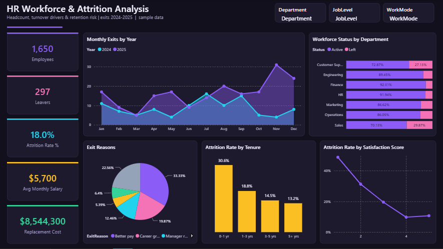
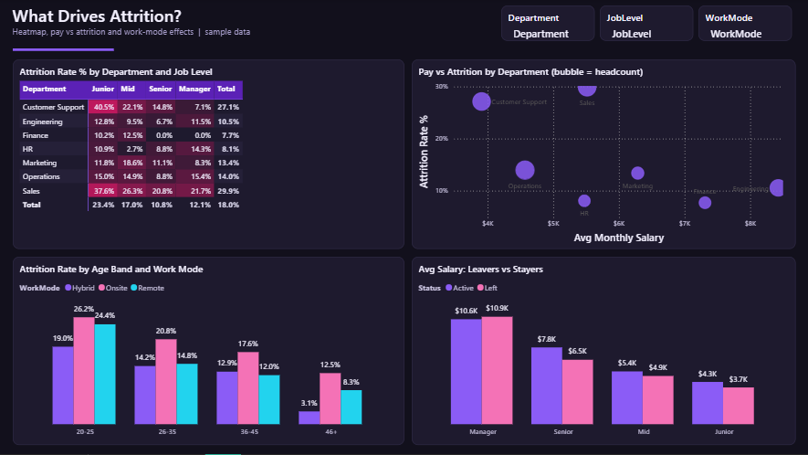

# HR Workforce & Attrition Analysis

**Sector:** Human Resources  |  **Tools:** Power BI (star schema, DAX)  |  **Data:** 1,650 rows, simulated

> A 1,650-employee services company saw resignations climb and wants to know who is leaving, why, and what it costs. HR needs a dashboard that management can filter by department, level and work mode.

*The Excel version of this project is in [excel-dashboards](https://github.com/ahmedsalamsali/excel-dashboards/tree/main/02-hr-attrition).*

## Power BI report

## Business questions

1. What is our attrition rate and how did exits trend in 2024 vs 2025?
2. Which departments, levels and tenure groups lose the most people?
3. Do overtime, pay and satisfaction explain who leaves?
4. What are the main exit reasons?
5. Where should HR act first?

## Key insights

- 297 of 1,650 employees left during 2024-2025 (attrition 18.0%); exits rose from 103 in 2024 to 194 in 2025.
- Sales (29.9%) and Customer Support (27.1%) lose staff 2-3x faster than Finance (7.7%).
- Employees working overtime leave at 31.0% vs 11.9% without overtime.
- Satisfaction is the strongest signal: score 1 = 48.8% attrition, score 5 = 10.7%.
- New joiners are most at risk: 30.6% of employees with under 1 year of tenure left vs 13.2% of 5+ year staff.
- 'Better pay' is the #1 exit reason (33.3% of leavers); leavers were paid less than stayers at every level except Manager.
- Estimated replacement cost of leavers is about $8.54M (6 months of salary each).

## Recommendations

- Run a pay-equity review for employees more than 8% below their department/level median, starting with Customer Support and Sales.
- Cap recurring overtime and add staffing in Customer Support; track overtime hours monthly as an early-warning KPI.
- Strengthen onboarding (buddy program, 30-60-90 day check-ins) to cut first-year attrition.
- Use the quarterly satisfaction pulse to flag score 1-2 employees for a manager conversation.

## What is inside

| File | Contents |
|---|---|
| `PowerBI/HRAttrition.pbip` | Power BI project: 2 report pages, 13 DAX measures, custom theme |
| `PowerBI/data/` | Source CSV files (fact + dimension tables) |
| `PowerBI/DAX_Measures.dax` | All measures with descriptions |
| `screenshots/` | Dashboard images |

## Power BI model

- **Fact table:** `Employees`; **`Date`** table generated in Power Query (marked as date table).
- Measures are grouped in display folders in a dedicated `_Measures` table: `Employees`, `Active Headcount`, `Leavers`, `Exits`, `Attrition Rate %`, `Overtime Attrition %`, `No-Overtime Attrition %`, `First-Year Attrition %`, `Exits YoY %`, `Avg Monthly Salary` ...
- Report pages: **Attrition Overview**, **Attrition Drivers**.

## How to open the Power BI file

1. Open `PowerBI/HRAttrition.pbip` in Power BI Desktop (it opens like a .pbix).
2. If you moved the folder: **Transform data > Edit parameters > DataFolder** and point it to the `PowerBI/data/` folder, then **Refresh**.
3. To get a single file: **File > Save as** and choose *Power BI file (.pbix)*.

---
*All data is simulated for portfolio purposes; company names are fictional.*  
*Prepared by Ahmed Abdulsalam - Data Analyst.*
