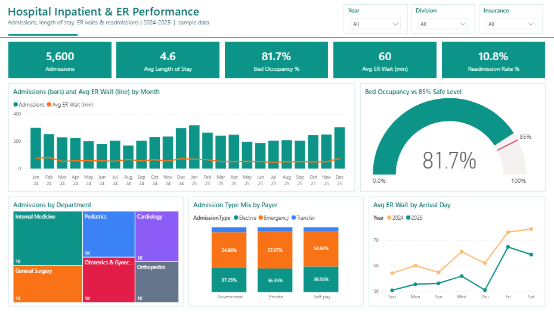
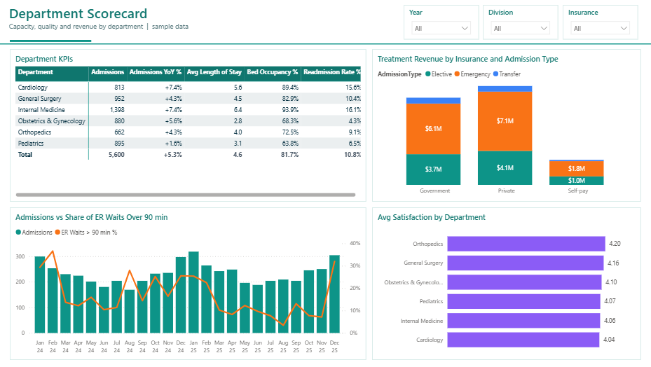

# Hospital Inpatient & ER Performance

**Sector:** Healthcare  |  **Tools:** Power BI (star schema, DAX)  |  **Data:** 5,600 rows, simulated

> A 6-department general hospital wants to track patient flow and quality. Leadership asks whether the 2025 ER triage project worked, where beds are under pressure, and which patients are coming back within 30 days.

*The Excel version of this project is in [excel-dashboards](https://github.com/ahmedboezz/excel-dashboards/tree/main/03-hospital-performance).*

## Power BI report

## Business questions

1. How many patients did we admit, and how did volume move by month and season?
2. Did ER waiting time improve in 2025?
3. Which departments have the longest stays and highest bed pressure?
4. Who is readmitted within 30 days?
5. How do waiting times affect patient satisfaction?

## Key insights

- Admissions grew 5.3% in 2025 (2,728 to 2,872); winter months (Dec-Feb) carry 31.0% of the volume.
- Average ER wait fell from 64 to 56 minutes after the 2025 triage project; Fridays and Saturdays are still the slowest days.
- The 30-day readmission rate improved from 11.2% to 10.5%; patients aged 65+ are readmitted at 17.0% vs 8.9% for others.
- Internal Medicine averages 94% bed occupancy (above the 85% safe level); Pediatrics runs at 64%.
- Internal Medicine has the longest average stay (6.4 days) vs 2.8 days in Obstetrics & Gynecology.
- ER patients who waited over 90 minutes rate their stay 3.26/5 vs 4.18/5 for waits under 45 minutes.

## Recommendations

- Open winter surge beds (or flex beds from Pediatrics) for Internal Medicine from December to February.
- Extend the 2025 triage model to Friday/Saturday ER shifts, where waits are still longest.
- Add a post-discharge follow-up call within 72 hours for patients aged 65+.
- Review discharge criteria in high-readmission departments (Cardiology, Internal Medicine).

## What is inside

| File | Contents |
|---|---|
| `PowerBI/HospitalOps.pbip` | Power BI project: 2 report pages, 16 DAX measures, custom theme |
| `PowerBI/data/` | Source CSV files (fact + dimension tables) |
| `PowerBI/DAX_Measures.dax` | All measures with descriptions |
| `screenshots/` | Dashboard images |

## Power BI model

- **Fact table:** `Admissions`; **dimensions:** `Departments`; **`Date`** table generated in Power Query (marked as date table).
- Measures are grouped in display folders in a dedicated `_Measures` table: `Admissions`, `Patient Days`, `Avg Length of Stay`, `Beds`, `Bed Occupancy %`, `Avg ER Wait (min)`, `ER Waits > 90 min %`, `Readmissions`, `Readmission Rate %`, `Avg Satisfaction` ...
- Report pages: **Hospital Overview**, **Department Scorecard**.

## How to open the Power BI file

1. Open `PowerBI/HospitalOps.pbip` in Power BI Desktop (it opens like a .pbix).
2. If you moved the folder: **Transform data > Edit parameters > DataFolder** and point it to the `PowerBI/data/` folder, then **Refresh**.
3. To get a single file: **File > Save as** and choose *Power BI file (.pbix)*.

---
*All data is simulated for portfolio purposes; company names are fictional.*  
*Prepared by Ahmed Abdulsalam - Data Analyst.*

---
© 2026 Ahmed Abdulsalam. All rights reserved. See [LICENSE](../LICENSE).
