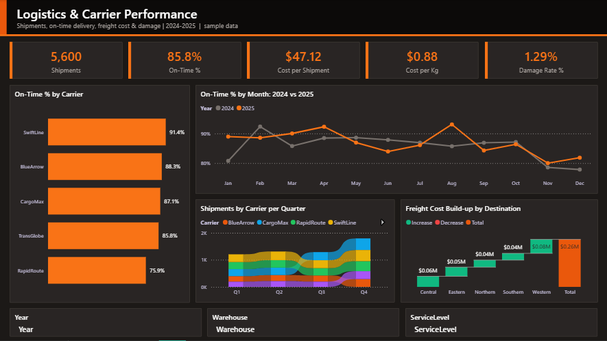
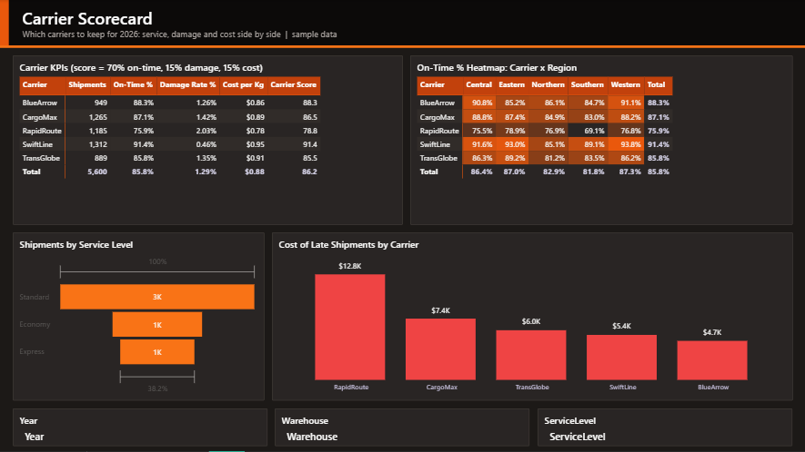

# Logistics & Carrier Performance

**Sector:** Supply Chain / Logistics  |  **Tools:** Power BI (star schema, DAX)  |  **Data:** 5,600 rows, simulated

> A distributor ships from three distribution centres with five carriers. Customer complaints about late and damaged deliveries are rising, and procurement must decide which carriers to keep for 2026.

*The Excel version of this project is in [excel-dashboards](https://github.com/ahmedsalamsali/excel-dashboards/tree/main/04-logistics-carriers).*

## Power BI report

## Business questions

1. How many shipments did we send and what share arrived on time?
2. Which carrier gives the best balance of cost, speed and damage?
3. How does peak season affect delivery performance?
4. Which destination regions are hardest to serve?
5. What does freight cost per kg and per shipment?

## Key insights

- Volume grew 12.7% in 2025 (2,633 to 2,967 shipments); on-time delivery moved from 85.1% to 86.3%.
- SwiftLine is the most reliable carrier (91.4% on time); RapidRoute is the cheapest per kg ($0.78) but delivers only 75.9% on time and has the highest damage rate (2.0%).
- Peak season hurts service: on-time falls to 79.8% in Nov-Dec vs 87.5% in the rest of the year.
- Southern and Northern regions have the lowest on-time rates (81.8%, 82.9%).
- Late shipments represent $36.4K of freight spend over two years, with knock-on customer service costs.

## Recommendations

- Move peak-season and Northern/Southern volume from RapidRoute to SwiftLine or BlueArrow; the saving per kg does not cover the service and damage cost.
- Agree an on-time SLA with penalties (e.g. 92%) in the 2026 carrier contracts.
- Book extra peak capacity in October and add one buffer day to promised dates in Nov-Dec for remote regions.
- Track damage claims by carrier monthly and require packaging audits above 1.5%.

## What is inside

| File | Contents |
|---|---|
| `PowerBI/LogisticsOps.pbip` | Power BI project: 2 report pages, 15 DAX measures, custom theme |
| `PowerBI/data/` | Source CSV files (fact + dimension tables) |
| `PowerBI/DAX_Measures.dax` | All measures with descriptions |
| `screenshots/` | Dashboard images |

## Power BI model

- **Fact table:** `Shipments`; **dimensions:** `Carriers`; **`Date`** table generated in Power Query (marked as date table).
- Measures are grouped in display folders in a dedicated `_Measures` table: `Shipments`, `Total Weight (kg)`, `On-Time Shipments`, `On-Time %`, `Late Shipments`, `Avg Delay (late only)`, `Avg Transit Days`, `Damage Rate %`, `Freight Cost`, `Cost per Shipment` ...
- Report pages: **Delivery Overview**, **Carrier Scorecard**.

## How to open the Power BI file

1. Open `PowerBI/LogisticsOps.pbip` in Power BI Desktop (it opens like a .pbix).
2. If you moved the folder: **Transform data > Edit parameters > DataFolder** and point it to the `PowerBI/data/` folder, then **Refresh**.
3. To get a single file: **File > Save as** and choose *Power BI file (.pbix)*.

---
*All data is simulated for portfolio purposes; company names are fictional.*  
*Prepared by Ahmed Abdulsalam - Data Analyst.*
