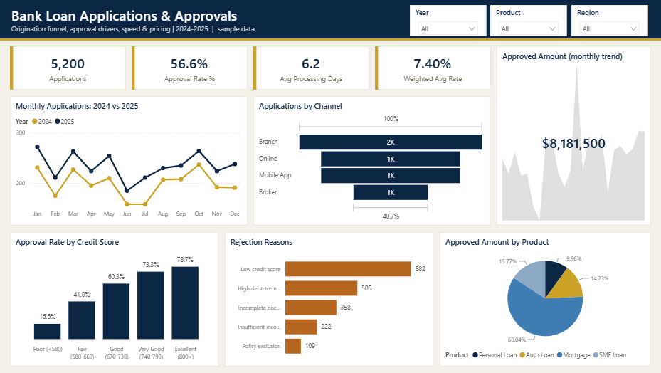
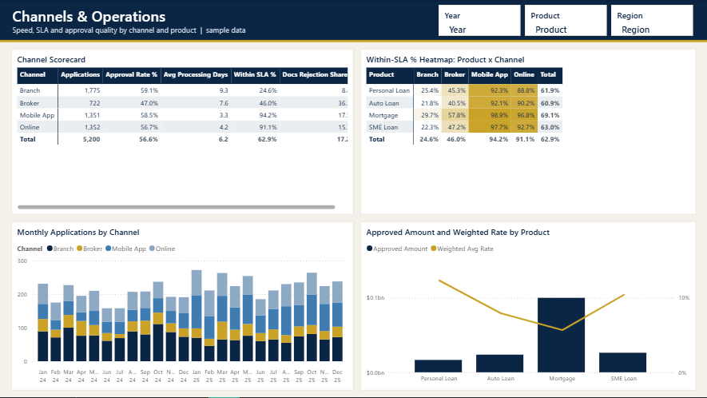

# Bank Loan Applications & Approvals

**Sector:** Banking / Finance  |  **Tools:** Power BI (star schema, DAX)  |  **Data:** 5,200 rows, simulated

> A retail bank's lending team wants to understand its loan origination funnel: how many applications arrive by channel, how many are approved, why the rest are rejected, and how fast decisions are made.

*The Excel version of this project is in [excel-dashboards](https://github.com/ahmedboezz/excel-dashboards/tree/main/05-bank-loan-applications).*

## Power BI report

## Business questions

1. How many applications did we receive and approve, and how much did we lend?
2. How does approval rate change with credit score and debt-to-income?
3. Which channels are growing and which are slowest?
4. Why are applications rejected?
5. Are we meeting our decision-time SLA?

## Key insights

- Applications grew 17.7% in 2025 and approved lending reached $92.13M (23.8% vs 2024).
- Mobile App share of applications jumped from 18.8% to 32.1%; it is the fastest channel (3.3 days on average vs 9.3 in branches).
- Approval rate is 57.6% in 2025; it ranges from 16.6% for Poor credit to 78.7% for Excellent.
- 'Incomplete documents' causes 17.2% of all rejections, and 36.3% of Broker-channel rejections.
- Decisions within SLA improved from 52.9% to 71.5%; mortgages and SME loans remain the slowest products.

## Recommendations

- Add a document checklist and upload validation for Broker submissions; most of these rejections are avoidable.
- Keep shifting volume to the Mobile App (pre-filled data, instant decision for Personal Loans).
- Offer secured or smaller-amount alternatives to Fair-score applicants instead of a straight rejection.
- Set up a dedicated underwriting queue for SME loans to bring processing time inside the 10-day SLA.

## What is inside

| File | Contents |
|---|---|
| `PowerBI/LoanApps.pbip` | Power BI project: 2 report pages, 15 DAX measures, custom theme |
| `PowerBI/data/` | Source CSV files (fact + dimension tables) |
| `PowerBI/DAX_Measures.dax` | All measures with descriptions |
| `screenshots/` | Dashboard images |

## Power BI model

- **Fact table:** `Applications`; **dimensions:** `Products`; **`Date`** table generated in Power Query (marked as date table).
- Measures are grouped in display folders in a dedicated `_Measures` table: `Applications`, `Approved`, `Rejected`, `Approval Rate %`, `Requested Amount`, `Approved Amount`, `Avg Ticket (approved)`, `Avg Interest Rate`, `Weighted Avg Rate`, `Avg Processing Days` ...
- Report pages: **Lending Overview**, **Channels & Operations**.

## How to open the Power BI file

1. Open `PowerBI/LoanApps.pbip` in Power BI Desktop (it opens like a .pbix).
2. If you moved the folder: **Transform data > Edit parameters > DataFolder** and point it to the `PowerBI/data/` folder, then **Refresh**.
3. To get a single file: **File > Save as** and choose *Power BI file (.pbix)*.

---
*All data is simulated for portfolio purposes; company names are fictional.*  
*Prepared by Ahmed Abdulsalam - Data Analyst.*

---
© 2026 Ahmed Abdulsalam. All rights reserved. See [LICENSE](../LICENSE).
