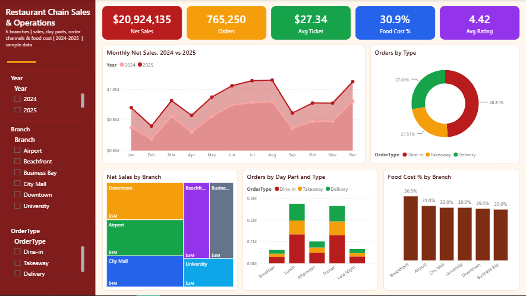
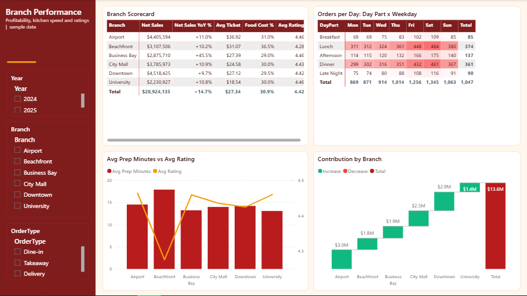

# Restaurant Chain Sales & Operations

**Sector:** Food & Beverage / Hospitality  |  **Tools:** Power BI (star schema, DAX)  |  **Data:** 61,339 rows, simulated

> A casual-dining chain with six branches (about 950 orders a day) wants one dashboard for owners and branch managers: which branches and day parts drive sales, how fast delivery is growing, and where food cost and kitchen speed are out of line.

*The Excel version of this project is in [excel-dashboards](https://github.com/ahmedsalamsali/excel-dashboards/tree/main/06-restaurant-chain-sales).*

## Power BI report

## Business questions

1. How did net sales, orders and average ticket change in 2025?
2. Which branches perform best, and which have cost problems?
3. Which day parts and weekdays are the busiest?
4. How is the order mix shifting between dine-in, takeaway and delivery?
5. Does kitchen preparation time affect customer ratings?

## Key insights

- Net sales grew 14.7% in 2025 to $11.18M; orders grew 12.3% and the average ticket moved from $27.03 to $27.62.
- Lunch and dinner generate 70.2% of all orders; Friday and Saturday are the busiest days.
- Delivery rose from 23.6% to 31.3% of orders; aggregator commissions cost $759.4K over two years.
- Business Bay is the fastest-growing branch (+45.5%) thanks to weekday office lunches.
- Airport has the highest average ticket ($36.92) and University the lowest ($18.54).
- Beachfront food cost is 36.5% of sales vs 30.0% elsewhere, about $208.0K of excess cost (waste or portioning).
- Day parts with prep time above 20 minutes are rated 3.96/5 vs 4.52/5 when prep is 14 minutes or less.

## Recommendations

- Audit Beachfront portion sizes and waste logs; bringing food cost in line with other branches recovers most of the excess.
- Push direct ordering through the brand's own app (loyalty points, free-delivery threshold) to cut aggregator commission.
- Add kitchen staff for lunch and dinner rush (and Beachfront in summer) to keep prep time under 15 minutes.
- Replicate the Business Bay office-lunch offer (set menus, pre-order) at Downtown and City Mall.

## What is inside

| File | Contents |
|---|---|
| `PowerBI/RestaurantSales.pbip` | Power BI project: 2 report pages, 17 DAX measures, custom theme |
| `PowerBI/data/` | Source CSV files (fact + dimension tables) |
| `PowerBI/DAX_Measures.dax` | All measures with descriptions |
| `screenshots/` | Dashboard images |

## Power BI model

- **Fact table:** `Sales`; **dimensions:** `Branches`; **`Date`** table generated in Power Query (marked as date table).
- Measures are grouped in display folders in a dedicated `_Measures` table: `Net Sales`, `Gross Sales`, `Orders`, `Avg Ticket`, `Items per Order`, `Orders per Day`, `Sales per Seat`, `Food Cost`, `Food Cost %`, `Aggregator Commission` ...
- Report pages: **Sales Overview**, **Branch Performance**.

## How to open the Power BI file

1. Open `PowerBI/RestaurantSales.pbip` in Power BI Desktop (it opens like a .pbix).
2. If you moved the folder: **Transform data > Edit parameters > DataFolder** and point it to the `PowerBI/data/` folder, then **Refresh**.
3. To get a single file: **File > Save as** and choose *Power BI file (.pbix)*.

---
*All data is simulated for portfolio purposes; company names are fictional.*  
*Prepared by Ahmed Abdulsalam - Data Analyst.*
