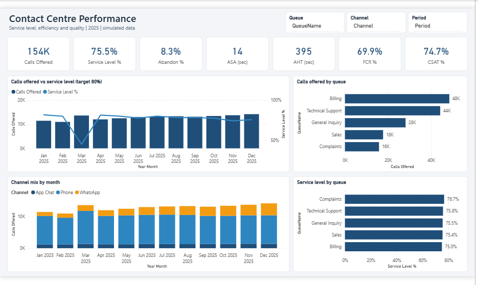
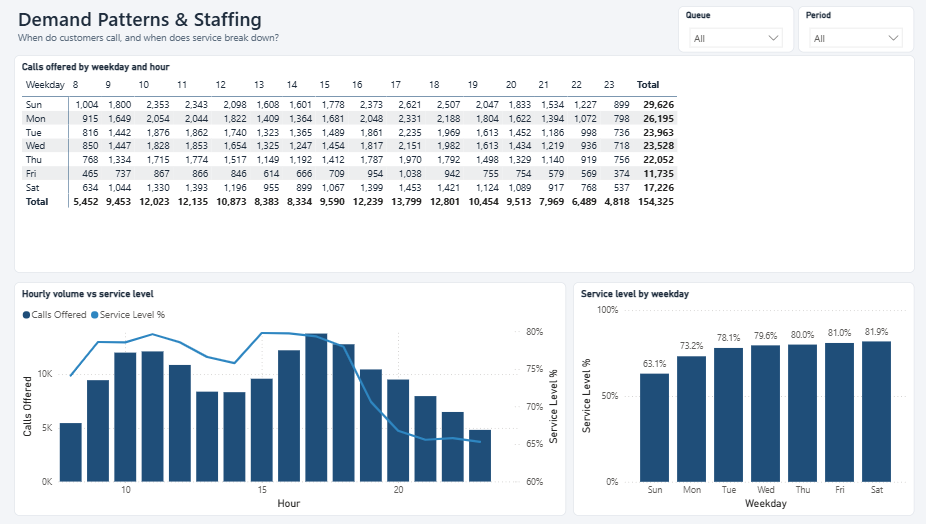
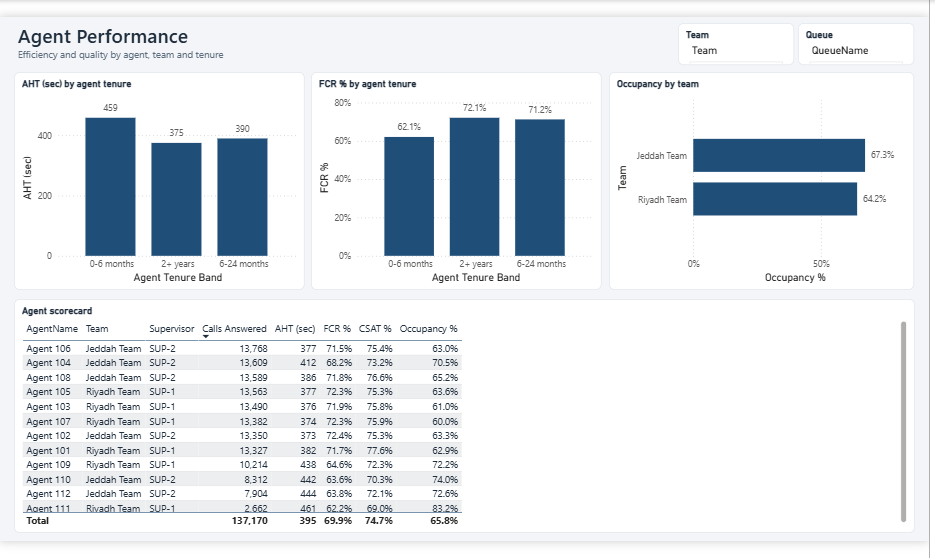
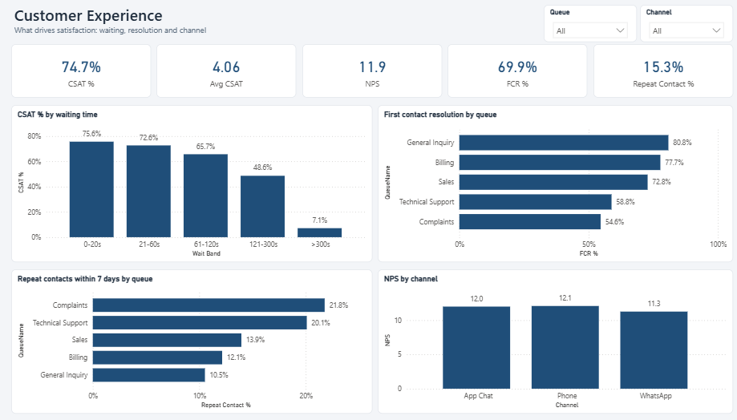

# Contact Centre Performance & Customer Experience (Power BI)

> **Note:** simulated data for a realistic business scenario (portfolio case study). Client name withheld/fictional.

| Pages | Key measures |
|---|---|
| Service Overview · Demand & Staffing · Agent Performance · Customer Experience | Service level (80/20), abandon %, ASA, AHT, FCR (7-day repeat), occupancy, CSAT, NPS |

**Techniques:** 7-day repeat contacts via an **index self-join** in Power Query, agent tenure at call time, two fact tables (calls and agent logins) sharing dimensions, and NPS that handles blank survey answers correctly.

## Report pages

**Service Overview**

**Demand & Staffing**

**Agent Performance**

**Customer Experience**

## Findings
* Service level **75.5%** vs 80% target: **63% on Sundays** and **43% in Ramadan** (13% after 9 pm), because shifts are planned for an average day.
* New agents (0-6 months): AHT 459s vs 375s and FCR 62% vs 72%.
* CSAT 76% when answered within 20s vs 7% after 5 minutes. WhatsApp share grew from 11% to 27%.

## How to open
1. Install a recent **Power BI Desktop** and open `ContactCenter.pbip`. The project is saved in the Power BI Project format (TMDL model + PBIR report), so it's readable in Git.
2. Click **Refresh now** (or Home → Refresh → *Schema and data*). If you moved the folder: Transform data → Edit parameters → `DataFolder`.
3. Screenshots of every page are in [`screenshots/`](screenshots).

---
© 2026 Ahmed Abdulsalam. All rights reserved. See [LICENSE](../LICENSE).
