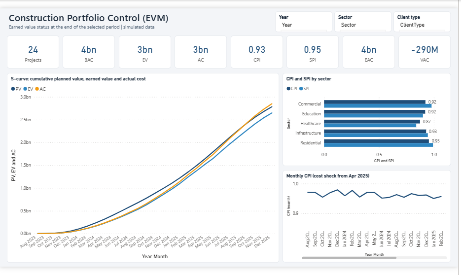
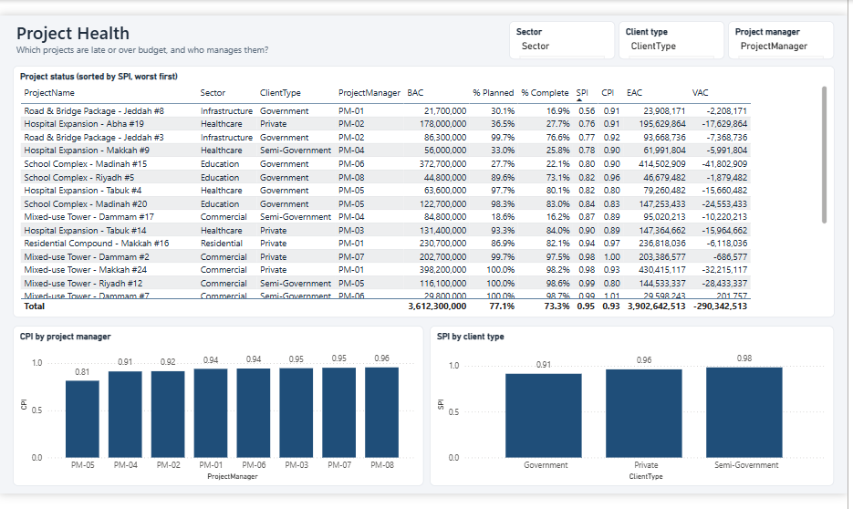
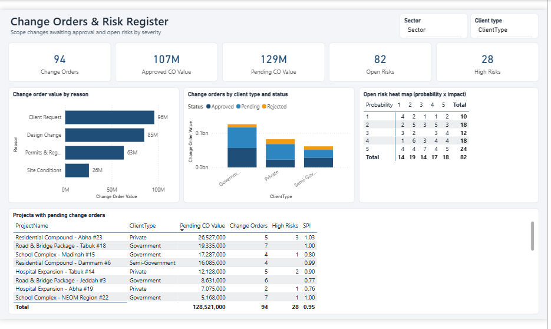

# Construction Portfolio Control with Earned Value Management (Power BI)

> **Note:** simulated data for a realistic business scenario (portfolio case study). Client name withheld/fictional.

| Pages | Key measures |
|---|---|
| Portfolio Overview · Project Health · Change Orders & Risks | Cumulative PV / EV / AC (S-curve), CPI, SPI, EAC, VAC, monthly CPI, change-order exposure, risk heat map |

**Techniques:** running totals with `FILTER(ALL('Date'))`, **project-level EAC with SUMX + context transition**, ERP period parsing, probability × impact risk matrix.

## Report pages

**Portfolio Overview**

**Project Health**

**Change Orders & Risks**

## Findings
* 24 projects, BAC SAR 3.61B: **CPI 0.93, SPI 0.95**, forecast overrun **SAR 290M**.
* Material price shock: monthly CPI fell from 0.96 to 0.90 after April 2025.
* Healthcare projects worst (SPI 0.84); PM-05 at CPI 0.81.
* Pending change orders (SAR 129M) exceed approved ones; 28 high risks open.

## How to open
1. Install a recent **Power BI Desktop** and open `ConstructionEVM.pbip`. The project is saved in the Power BI Project format (TMDL model + PBIR report), so it's readable in Git.
2. Click **Refresh now** (or Home → Refresh → *Schema and data*). If you moved the folder: Transform data → Edit parameters → `DataFolder`.
3. Screenshots of every page are in [`screenshots/`](screenshots).

---
© 2026 Ahmed Abdulsalam. All rights reserved. See [LICENSE](../LICENSE).
